<div align="center">



# 🌪️ Awesome Atmospheric Modeling & Weather Simulation 🛰️

<a href="https://github.com/ishandutta2007/Awesome-Awesome-Awesome"></a><a href="https://discord.gg/jc4xtF58Ve"></a>
[](https://awesome.re)
[](https://github.com/ishandutta2007/Awesome-Atmospheric-Modeling-Weather-Simulation/stargazers)
[](https://opensource.org/licenses/MIT)
[](https://github.com/ishandutta2007/Awesome-Atmospheric-Modeling-Weather-Simulation/graphs/commit-activity)
[](https://github.com/ishandutta2007/Awesome-Atmospheric-Modeling-Weather-Simulation/blob/main/README.md#how-to-contribute)
<a href="https://github.com/ishandutta2007"></a>

**A curated index of Numerical Weather Prediction (NWP) physics engines, foundational AI weather forecasting models, enterprise meteorological APIs, and open-source atmospheric simulation software.**

*Forecasting, simulating, assimilating, and downscaling global and hyperlocal atmospheric telemetry.*

📅 **Last updated:** November 2026

</div>

---

## 📑 Table of Contents

- [🌍 Sector Overview & Market Dynamics](#-sector-overview--market-dynamics)
- [🏢 SaaS & Hosted Platforms](#-saas--hosted-platforms)
- [💻 Open-Source GitHub Projects](#-open-source-github-projects)
- [🧩 Building Modern Weather Workflows](#-building-modern-weather-workflows)
- [🤝 How to Contribute](#-how-to-contribute)
- [💖 Support & Sponsorship](#-support--sponsorship)
- [📈 Star History](#-star-history)
- [⚠️ Disclaimer](#️-disclaimer)

---

## 🌍 Sector Overview & Market Dynamics

The global weather forecasting services and weather intelligence market is valued at approximately **$2.5 billion to $3.9 billion** (projected to reach over **$5.8 billion by 2033** at a ~6.8% CAGR). The market structure is **moderately fragmented**, balancing legacy enterprise incumbents (DTN, AccuWeather, The Weather Company) against specialized satellite and AI-native high-resolution challengers (Tomorrow.io, Spire Global, Meteomatics).

Enterprise demand is rapidly shifting from passive observation lookups toward embedded, sub-hourly weather intelligence feeds across renewable energy dispatch, aviation risk management, predictive supply chains, and parametric catastrophic reinsurance.

---

## 🏢 SaaS & Hosted Platforms

The following table compares leading commercial and hosted weather platforms. Entries are sorted in descending order by estimated enterprise scale, valuation, or parent valuation.

| Provider / Platform | Scale (Valuation / Revenue) | Starting Pricing (Paid Tiers) | Free Tier Limit / Free Trial | Core Atmospheric & Weather Capabilities |
| :--- | :--- | :--- | :--- | :--- |
| **[Tomorrow.io](https://tomorrow.io)** 🛰️ | **~$1.0B+ Valuation** (Series F / ~$100M ARR) | Metered volume plans (custom quotes for commercial enterprise) | **Free Forever Tier**: 500 requests/day (25/hr, 3/sec max), 5-day forecast, 1 location, 1 alert rule | Hyperlocal precipitation radar nowcasting, proprietary Low Earth Orbit (LEO) microwave/radar satellite constellation telemetry, and automated operational risk rules. |
| **[DTN Weather](https://dtn.com)** 🚜 | **~$900M Valuation** (Acquired by TBG AG / ABB) | Consumer apps start at **$16.99/mo**; Enterprise solutions via quote | **7-day Free Trial** for MyDTN Ag & Marine APIs; custom sandbox trial available on request | Enterprise meteorological decision support, WeatherSentry severe weather alerting, offshore wind/maritime routing, and aviation flight planning systems. |
| **[AccuWeather API](https://accuweather.com)** ⚡ | **~$200M–$900M Est. Valuation** (~$100M–$500M Revenue) | **$2/mo** (Starter package, 15,000 calls/mo; overages ~$0.12/1K calls) | **14-day Free Trial**: 500 calls/day Core Weather API, 50 calls/day MinuteCast® | MinuteCast® minute-by-minute localized precipitation indices, severe storm warnings, global postal-code multi-day forecasts, and health/lifestyle indices. |
| **[Spire Global](https://spire.com)** 📡 | **~$320M–$360M Market Cap** (NYSE: SPIR / ~$65M Revenue) | Enterprise & governmental contract subscriptions | **7-day Evaluation Trial** available via direct application (no permanent self-serve free tier) | Space-based GNSS Radio Occultation (GNSS-RO) atmospheric profiling, deep vertical sounding data, global dynamic NWP assimilation, and maritime/aviation routing. |
| **[Meteomatics](https://meteomatics.com)** 🚁 | **~$36M Funding Raised** (~$31.6M Est. Revenue) | Entry commercial API tiers from **€150/mo to €300/mo** | **14-day Free Trial**; Permanent **Free Basic Plan** for non-commercial hobbyist use (10-day forecast, 15 basic parameters) | 90-meter digital elevation model downscaling, 1,800+ meteorological parameters, autonomous Meteodrone atmospheric boundary layer soundings, and EURO1k/US1k models. |
| **[OpenWeatherMap](https://openweathermap.org)** 🌐 | **High-Scale Private** (London, UK; Millions of developers) | **$40/mo** (Startup tier, 1M calls/mo pooled); One Call API: $0.0015/call overage | **Free Forever Plan**: 60 calls/minute, up to 1,000,000 calls/month (One Call API includes 1,000 free calls/day) | Global current weather, 5-day/3-hour forecasts, One Call 3.0 timemachine archive, historical archives, radar map tile overlays, and air pollution indices. |
| **[Earth Networks](https://earthnetworks.com)** ⚡ | **~$25.5M Est. Revenue** (Subsidiary of AEM / Union Park) | Custom enterprise licensing based on sensor endpoints | **30-day Free Trial** for Sferic Mobile / Sferic Maps; live system enterprise demo on request | Total lightning detection network (in-cloud and cloud-to-ground), Sferic Maps emergency management dashboard, and automated outdoor siren alert systems. |
| **[Weatherbit](https://weatherbit.io)** 🌤️ | **Private / Bootstrapped** (~$5M–$10M Est. ARR) | **$45/mo** (Standard plan, 25,000 calls/day, 16-day forecast, commercial license) | **Free Forever Plan**: 50 calls/day (strictly non-commercial, 7-day daily forecast); 1,500 calls/day business trial | Fast REST and WebSocket weather feeds, ensemble probabilistic forecasts, solar radiation calculations, air quality indexes, and historical data archives. |
| **[Visual Crossing](https://visualcrossing.com)** 📊 | **Private / Independent** (Reston, VA; established 2003) | **$35/mo** (Base monthly tier) or pay-as-you-go at ~$0.0001 per additional record | **Free Forever Plan**: 1,000 records/day (supports commercial use, JSON/CSV/Excel, 15-day forecast, 50-year history) | Global historical weather data (hourly back to 1970), 15-day forward forecasts, climate normal baselines, and native business intelligence integrations (Power BI, Excel). |

---

## 💻 Open-Source GitHub Projects

The following curated open-source tools power modern atmospheric sciences, mesoscale weather prediction, AI foundation weather modeling, and data pipelines. 

> Repositories are ranked in descending order by **GitHub Star Count**. Star badges link directly to each repository's stargazers community.

| Rank | Project & Repository | Stars | Category / Focus | Key Features |
| :---: | :--- | :---: | :--- | :--- |
| 1 | **[GraphCast](https://github.com/google-deepmind/graphcast)** 🧠 | [](https://github.com/google-deepmind/graphcast/stargazers) | Foundation AI Weather Model | Google DeepMind's state-of-the-art graph neural network (GNN) model producing 10-day global forecasts at 0.25° resolution in under 60 seconds on Google Cloud TPUs. |
| 2 | **[Open-Meteo](https://github.com/open-meteo/open-meteo)** 🌐 | [](https://github.com/open-meteo/open-meteo/stargazers) | Self-Hosted Weather Forecast API | Open-source Swift API aggregating national weather models (NOAA GFS/HRRR, ECMWF IFS, DWD ICON, MeteoFrance) with zero API keys required and sub-millisecond response caching. |
| 3 | **[xarray](https://github.com/pydata/xarray)** 📈 | [](https://github.com/pydata/xarray/stargazers) | Multidimensional Data Toolkit | Foundational Python data structure for labeled N-dimensional arrays; powers climate, atmospheric science, NetCDF, GRIB, and Zarr dataset operations. |
| 4 | **[WRF Model](https://github.com/wrf-model/WRF)** 🌪️ | [](https://github.com/wrf-model/WRF/stargazers) | Mesoscale NWP Simulator | The Weather Research and Forecasting (WRF) model; the global scientific standard for regional atmospheric physics modeling, climate research, and operational weather prediction. |
| 5 | **[Cartopy](https://github.com/SciTools/cartopy)** 🗺️ | [](https://github.com/SciTools/cartopy/stargazers) | Geospatial Projection & Maps | Essential Python package designed for geospatial data processing and producing publication-quality cartographic weather and atmospheric maps. |
| 6 | **[MetPy](https://github.com/Unidata/MetPy)** 📐 | [](https://github.com/Unidata/MetPy/stargazers) | Meteorological Python Library | Unidata's suite for meteorological calculations, thermodynamic Skew-T soundings, kinematic calculations, and standard weather symbol station plotting. |
| 7 | **[earth2studio](https://github.com/NVIDIA/earth2studio)** 🚀 | [](https://github.com/NVIDIA/earth2studio/stargazers) | AI Weather Framework (NVIDIA) | NVIDIA's open-source framework for building, evaluating, and deploying AI weather pipelines, ensemble inference (FourCastNet, SFNO, CorrDiff), and data assimilation. |
| 8 | **[Aurora](https://github.com/microsoft/aurora)** 🌌 | [](https://github.com/microsoft/aurora/stargazers) | Foundation AI Weather Model | Microsoft's atmospheric foundation model trained on over 1M hours of geophysical simulations; predicts global weather, air quality, and atmospheric chemistry. |
| 9 | **[Herbie](https://github.com/blaylockbk/Herbie)** 🛰️ | [](https://github.com/blaylockbk/Herbie/stargazers) | NWP Model Data Retriever | Streamlined Python library for discovering, downloading, and indexing GRIB2 weather forecast files from NOAA (HRRR, RAP, GFS, NBM) and ECMWF open data cloud buckets. |
| 10 | **[Iris](https://github.com/SciTools/iris)** 🔬 | [](https://github.com/SciTools/iris/stargazers) | Earth Science Analytics | Developed by the UK Met Office; provides CF-compliant data models for analyzing and visualizing multi-dimensional meteorological and oceanographic data. |
| 11 | **[wrf-python](https://github.com/NCAR/wrf-python)** 🐍 | [](https://github.com/NCAR/wrf-python/stargazers) | NWP Post-Processing | NCAR's diagnostics and interpolation toolkit for WRF-ARW output, calculating geopotential height, dewpoint, equivalent potential temperature, and wind barbs. |
| 12 | **[CLIMADA](https://github.com/CLIMADA-project/climada_python)** 🌪️ | [](https://github.com/CLIMADA-project/climada_python/stargazers) | Climate & Weather Risk Engine | ETH Zurich's probabilistic natural catastrophe and extreme weather impact modeling platform estimating economic and socioeconomic climate risks. |
| 13 | **[CESM](https://github.com/ESCOMP/CESM)** 🌍 | [](https://github.com/ESCOMP/CESM/stargazers) | Global Climate Simulator | The Community Earth System Model; fully-coupled global simulation system simulating interactions between atmosphere, ocean, sea-ice, land-ice, and biogeochemistry. |
| 14 | **[cfgrib](https://github.com/ecmwf/cfgrib)** 📦 | [](https://github.com/ecmwf/cfgrib/stargazers) | GRIB Engine Driver | ECMWF's engine for mapping WMO GRIB1 and GRIB2 files into the NetCDF Common Data Model using xarray and ecCodes. |
| 15 | **[windrose](https://github.com/python-windrose/windrose)** 💨 | [](https://github.com/python-windrose/windrose/stargazers) | Wind Data Visualization | Python toolkit for analyzing wind distributions and plotting meteorological wind roses, frequency charts, and direction distributions. |
| 16 | **[MPAS-Model](https://github.com/MPAS-Dev/MPAS-Model)** 🌐 | [](https://github.com/MPAS-Dev/MPAS-Model/stargazers) | Unstructured Voronoi NWP | Next-generation atmospheric simulation framework using unstructured spherical Voronoi meshes for seamless cross-scale global-to-regional simulations. |
| 17 | **[ecCodes](https://github.com/ecmwf/eccodes)** ⚙️ | [](https://github.com/ecmwf/eccodes/stargazers) | WMO Meteorological Parser | ECMWF's C/Fortran/Python library for decoding and encoding WMO format datasets including GRIB edition 1 and 2, BUFR edition 3 and 4, and GTS headers. |
| 18 | **[WindNinja](https://github.com/firelab/windninja)** 🔥 | [](https://github.com/firelab/windninja/stargazers) | Diagnostic Wind Modeler | High-resolution diagnostic surface wind flow model developed by the USDA Forest Service for complex terrain wind simulation and wildfire behavior modeling. |
| 19 | **[CliMT](https://github.com/CliMT/climt)** 🎛️ | [](https://github.com/CliMT/climt/stargazers) | Modular Atmospheric Toolkit | Climate Modelling and Diagnostics Toolkit; modular Python environment for 1D, 2D, and 3D radiative-convective equilibrium and atmospheric dynamics simulation. |
| 20 | **[earthkit-data](https://github.com/ecmwf/earthkit-data)** 🗃️ | [](https://github.com/ecmwf/earthkit-data/stargazers) | Geospatial Data Ingestion | Modern ECMWF geospatial library simplifying access, transformation, and cache-handling for climate, meteorological, and marine data formats. |
| 21 | **[SynopticPy](https://github.com/blaylockbk/SynopticPy)** 📡 | [](https://github.com/blaylockbk/SynopticPy/stargazers) | Surface Weather API Client | Python wrapper for retrieving real-time and historical mesonets, ASOS, and AWOS surface observation networks via the Synoptic Weather API. |
| 22 | **[pw-tf/isowind](https://github.com/pw-tf/isowind)** 🎮 | [](https://github.com/pw-tf/isowind/stargazers) | Isometric Simulation Engine | OpenMW-derived community isometric simulation engine; an experiment in rendering atmospheric wind perspectives in virtual game spaces. |

---

## 🧩 Building Modern Weather Workflows

Modern meteorological computing pipelines combine physics-based simulation with machine learning inference and cloud API distribution:

```
[ Satellite Telemetry / Radars / Soundings ]
                   │
                   ▼
       [ Data Ingestion & Assimilation ]
       • Herbie (GRIB2 Download)
       • SynopticPy (Surface Mesonets)
       • cfgrib / ecCodes (WMO Decoding)
                   │
         ┌─────────┴─────────┐
         ▼                   ▼
[ NWP Physics Engines ]  [ AI Weather Foundation Models ]
• WRF Model (Mesoscale)   • GraphCast (DeepMind GNN)
• MPAS (Voronoi Mesh)     • Microsoft Aurora
• CESM (Global Climate)   • NVIDIA Earth-2 / SFNO
         │                   │
         └─────────┬─────────┘
                   ▼
     [ Post-Processing & Diagnostics ]
     • xarray + MetPy + wrf-python + Cartopy
                   │
                   ▼
      [ High-Speed API Delivery ]
      • Open-Meteo (Self-Hosted Fast Forecast API)
      • Tomorrow.io / Meteomatics / OpenWeather (SaaS Feeds)
```

---

## 🤝 How to Contribute

We welcome contributions from meteorologists, atmospheric researchers, and software engineers!

1. 🍴 **Fork the repository** on GitHub.
2. 🌿 **Create a feature branch**: `git checkout -b feature/add-meteorological-tool`
3. 📝 **Add your entry**:
   - For **SaaS platforms**: Add to the table with starting pricing, specific free tier/trial limits, valuation/revenue scale, and link.
   - For **Open-Source projects**: Include a star badge linking to the stargazers page (`https://img.shields.io/github/stars/<owner>/<repo>?style=social&color=white`), description, and sorted in descending order by star count.
4. 🚀 **Submit a Pull Request** with a concise description of why the tool is valuable for atmospheric modeling and weather simulation.

---

## 💖 Support & Sponsorship

Thank you for visiting and supporting this ecosystem initiative! If you find this curated collection of atmospheric modeling tools and weather simulation platforms valuable for your research, projects, or organization, please consider:

- ⭐ **Starring this repository** to help others discover it across GitHub.
- 🍴 **Forking and sharing** it with fellow meteorologists, climate researchers, and developers.
- ☕ **Supporting the creator**: If this work has helped you, you can show your support and buy a coffee through the [GitHub Sponsors Dashboard](https://github.com/sponsors/ishandutta2007). Every bit of support is deeply appreciated and fuels continued open-source curation!

---

## 📈 Star History

[](https://www.star-history.com/#ishandutta2007/Awesome-Atmospheric-Modeling-Weather-Simulation&type=date&legend=top-left)

---

## ⚠️ Disclaimer

- This curated repository is maintained for educational, research, and technical evaluation purposes.
- Numerical weather models and community forecasts should **never** be used as the sole resource for emergency management or life-safety decisions. Always refer to official government meteorological bodies (such as NOAA/NWS, ECMWF, DWD, UK Met Office, or JMA).
- Mesoscale physics solvers (e.g. `WRF`, `MPAS`) and AI foundation models (`GraphCast`, `Aurora`) require substantial high-performance compute clusters (MPI multi-node CPU clusters or high-VRAM accelerators).

---

<div align="center">

**[⬆ Back to Top](#-awesome-atmospheric-modeling--weather-simulation-)**

Made with ❤️ for the global atmospheric science, meteorology, and climate research community.

</div>
